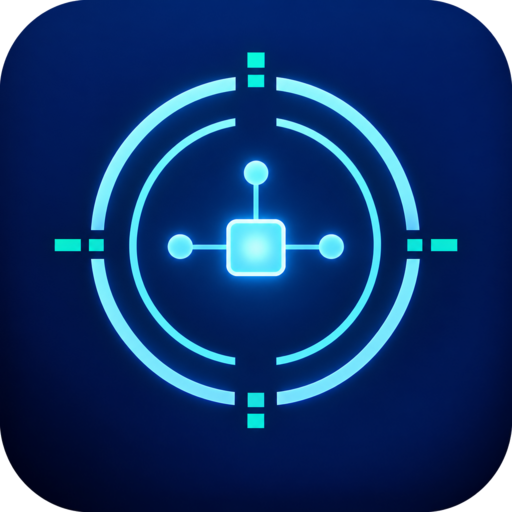

> [!CAUTION]
> ### Currently unusable with Star Citizen
>
> **The required game-side telemetry feature is currently unavailable in PTU
> and cannot be enabled.** The application cannot be used with the actual
> game for telemetry or controls. The development mock provides synthetic
> data only.

<p align="center"></p>

# Verse Data Gateway

Verse Data Gateway is an unofficial, independent community project for
Star Citizen. This Windows telemetry gateway turns selected game data into a
customizable phone or tablet MFD (multi-function display), with optional
game-supported controls.
Optionally, it forwards separately selected, aggregated telemetry to a
WebSocket receiver.

**Documentation: [Project wiki](https://github.com/zolij/verse-data-gateway/wiki)** —
setup, local MFD, troubleshooting, and privacy guides.

**Independent community project.** Not affiliated with, endorsed by, sponsored
by, or supported by Cloud Imperium Games.
Star Citizen and related marks belong to their respective owners.

**Use at your own risk.** The software is provided "AS IS" without warranties,
and the authors and contributors disclaim liability to the fullest extent
permitted by law. See the [disclaimer](docs/DISCLAIMER.md).

## Compatibility

The application targets **PTU only**; LIVE is unsupported. The PTU installation
checked on November 23, 2026 reported build `5.0.202.10025` (changelist
`13248297`; manifest dated November 20, 2026). The reconstructed telemetry
and action definitions were checked against the descriptors embedded in that
build. They are not an official or stable SDK. Compatibility with other builds,
game terms, or anti-cheat systems is not guaranteed. See [NOTICE](NOTICE) for
provenance.
For the recovered game-side schema, see the
[PTU telemetry protocol reference](docs/GAME-TELEMETRY.md).

## Design

- Native Windows x64 tray application, self-contained .NET 10 distribution.
- Loopback-only gRPC telemetry and game-supported action RPCs.
- Local MFD with approved devices and a separate, initially empty field allowlist.
- Optional remote upload with its own initially empty field allowlist; no automatic game telemetry uploads.
- Remote delivery uses five-second aggregation windows and WSS/JSON batch acknowledgements.
- Provider-neutral receiver endpoint and bounded in-memory buffering; no raw gameplay logs or disk telemetry queue.
- Remote API key protected with Windows DPAPI for the current user.
- Per-user Windows installer and approval-gated built-in updates.
- Separate, configurable application usage statistics with first-run notice.

## Windows quick start

The game configuration below is retained for when the required feature becomes
available again; it cannot currently enable the game-side service.

1. Download `Setup.exe` from [Releases](https://github.com/zolij/verse-data-gateway/releases),
   install it for your Windows user, then launch it from the Start menu/tray.
   Supported target: Windows 11 x64. No separate .NET runtime is required.
   Current previews are explicitly **unsigned**; Windows may show a
   publisher/SmartScreen warning. Trusted signing requires external approval.
   The ZIP from a successful [Actions run](https://github.com/zolij/verse-data-gateway/actions)
   remains available for portable use; extract all files before running the EXE.
2. To configure the game telemetry service persistently, add the following
   assignments to the PTU build's `user.cfg` (usually
   `...\Roberts Space Industries\StarCitizen\PTU\user.cfg`, not the `USER`
   subfolder), preserving any existing settings:

   ```text
   grpc.client.server.port = 29420
   grpc.client.server.external = 0
   server.game.telemetry.enabled = 1
   ```

   To permit game controls, also set
   `server.game.telemetry.trigger.actions.enabled = 1`. Without this game-side
   setting, control requests may be rejected.

   Restart Star Citizen after saving. For a current-session test, enter these
   commands in the game console instead:

   ```text
   grpc.client.server.port 29420
   grpc.client.server.external 0
   server.game.telemetry.enabled 1
   ```

   For controls, also enter `server.game.telemetry.trigger.actions.enabled 1`.

   The gateway defaults to game port `29420`. Keep its game port equal to the
   configured port and `external` set to `0`. Check the gateway setting and
   `user.cfg` together.

3. Open **Settings** in the dashboard. Under **Local MFD**, choose a network
   interface and port on a trusted network and enable local MFD access. The
   default MFD port is `29421`. Under **MFD fields**, select the values to share.
   Check the game port under **Game**, then apply the settings.
4. Choose **Start collection** explicitly. Open the dashboard's browser URL on
   a phone or tablet on the same network. Create a pairing code and scan its QR
   code with the phone camera, or enter the one-use code in the browser. Scanning
   or entering the code immediately authorizes the display.
5. Create an MFD profile in the browser and add instruments and game controls.
   Closing the dashboard leaves the tray running; double-click the tray icon to
   reopen it. Use **Pause and clear buffer** or the tray **Exit** to stop collection.

The local MFD uses unencrypted HTTP and WebSocket traffic: anyone on the network
may observe or modify the page, pairing codes, credentials, telemetry and game
commands. **Existing and newly paired displays can trigger game actions**, with
no separate gateway control switch. Use only a trusted network, configure
Windows Firewall yourself, and do not forward the port on your router. For
optional remote delivery, see [Receiver](#receiver).

The app neither starts with Windows nor resumes collection automatically.
Local MFD access is disabled until explicitly enabled; no network interface or
fields are selected automatically. Each field tab offers **Select all** and
**Clear all** for that destination only. Some fields contain sensitive values:
review the selection before enabling access. An empty selection can be saved,
but an enabled and configured destination with no selected fields cannot start.
Applying settings stops the current run, clears its window/queue and disconnects
local displays; Start again when ready. Already sent data cannot be recalled.
Receiver protocol or authentication errors are shown in collection status; when
the MFD is also enabled, remote delivery stops without stopping the local MFD.

Settings live in `%LOCALAPPDATA%\VerseDataGateway\settings.json`;
the separately DPAPI-encrypted key is `api-key.bin`, and approved local display
permissions are in `mfd-devices.json` (the file contains token hashes, not the
display credentials). Do not share these files.
Loss of the Windows user profile/key material may make the key unrecoverable;
enter it again instead of disabling protection. Corrupt settings are reported,
not silently replaced. Approved local displays remain authorized across
collection and application restarts until revoked. No telemetry values are
written to disk.

## Local phone/tablet MFD

Pairing codes are single-use and expire after two minutes. Scanning the QR code
automatically pairs the display; entering the code manually is also supported.
The browser retains its pairing token across browser and gateway restarts;
each browser also receives a stable generated identifier shown in the approved
device list. Approved devices can be revoked in the dashboard. The unencrypted
local interface does not use WSS, secure-context-only PWA features or remote
upload credentials. The generated identifier belongs to the browser's
storage for this gateway origin, not to the physical device; clearing that
storage resets it. Scanning a new QR code attempts a fresh pairing even if a
previous token is stored. Re-pairing the same browser replaces its earlier
permission and disconnects its old sessions. On gateway startup, duplicate
records for the same generated identifier are reduced to the most recent
permission; if the browser no longer has that token, pair it again.

The display starts empty, with no built-in layouts. Select **New profile** to
build your own MFD with named pages. In **Edit**, search the shared-field library
and add value tiles, status indicators or lists. Configure labels, decimal
precision and normal, wide or large tile sizes. Rearrange tiles by their move
handle, arrow keys or the Left/Right buttons. Status indicators map exact raw
values to your own labels and a fixed color palette. No graphs or arbitrary
formulas are included; measurement units are not inferred.

The editor lists known controls by category even when the game is unavailable.
The library includes a documented PTU snapshot and controls learned from the
game; it may be outdated and does not authorize actions. Each tile either
displays one telemetry field or triggers one game action. Controls with known
field associations require at least one associated field to be shared in PC MFD
settings. Vehicle lights on/off were verified against live PTU telemetry;
other field associations are based on names and marked as not live-verified.
Availability depends on the game,
active action map and game-side trigger setting; an unavailable saved control
is retained but disabled. A game response is shown on the tile, including in
Focus Mode. An accepted request is not proof of a state change. If a response
is lost, check the game before retrying.

Some actions can be held for a configured 1–5000 ms; the request runs for that
duration, not until the screen is released. Editing never triggers controls.
The interface asks for confirmation before eject, emergency exit or
self-destruct, but the game still decides whether any action is permitted.

**Value format** defaults to **Automatic**, including for existing profiles.
Shield level/faces and hydrogen fuel use 0–1 ratios (`0.75` → `75%`).
Quantum fuel retains its 0–100 default (`75` → `75%`); its scale has not been
verified in the current PTU because the sampled game stream omits this field.
Actor health, oxygen, hunger and thirst use
`current / max`: enable both the `current` and `max` fields in gateway MFD
settings. A missing, nonpositive or mismatched maximum is marked unavailable,
not replaced with an assumed scale. Other fields remain raw values.
Each tile can override this with **Raw value**, either percentage scale, or
**current divided by max** for a gauge. Overrides are saved/exported with the
profile; status rules still match the original raw values.

In **Edit**, use **Auto-switch to this page** to select one or more known game
events. An event can belong to only one page within a profile; assigning it
elsewhere asks for confirmation before moving it from the previous page.
Changes take effect after **Save to PC**, and triggers are included in exports.
Enable `events.events.type` in PC MFD settings and restart collection to receive
events; the editor warns when this is not enabled.

Only the active saved profile switches pages, and only on new events. Initial
connection/reconnection does not replay history. Automatic switching pauses
while editing; events received during editing are not replayed afterwards.
If several matching events arrive together, the last one wins.
Manual page selection remains available.

Select **Focus Mode** on a saved profile to show only its instruments and, for
multi-page profiles, the page switcher. Editing and management controls, headings
and other page chrome are hidden; telemetry freshness/unknown markers inside
tiles and automatic page triggers continue to work. **Exit Focus** remains
available as a touch-friendly escape, and Escape or the browser's fullscreen
exit restores the normal view. Focus mode is unavailable while editing and is
not remembered across reloads.

While focus mode is active, the display tries to stay awake. It uses the
browser's Screen Wake Lock API when available and otherwise plays a subtle,
silent local video background as a best-effort fallback for the HTTP MFD.
Some browsers or power-saving settings may still turn the screen off; successful playback does
not guarantee wakefulness. A failed or interrupted request is reported in
focus mode. The attempt ends on exit and is retried when the page becomes
visible again.

Entering focus mode requests full screen directly from the button tap, including
on supported phone/tablet browsers. Some browsers, notably iPhone browsers, do
not support fullscreen for arbitrary page elements; focus mode still works and
shows an explicit notice instead of claiming full screen. On iPhone/iPad, use
Safari's **Add to Home Screen**, launch the page from there, then select
**Focus Mode** for a standalone display without browser bars. Browser/platform
restrictions cannot be overridden by the gateway.

Select **Save to PC** to publish a layout, or **Cancel** to discard its draft.
Profiles are stored in `mfd-profiles.json` under
`%LOCALAPPDATA%\VerseDataGateway`, survive gateway restarts, and are
shared by all approved displays. Each browser chooses its own active profile
and page; when only one profile exists, it is selected automatically. Every
approved display can edit or delete shared profiles. If another
display saves first, your draft is retained: reload the saved profile or save
your changes as a new profile instead of overwriting it.

**Duplicate**, **Export** and **Import** let you reuse layouts. Export includes
the current draft when editing; imports create new profiles and never enable
additional telemetry fields. Up to 32 profiles, 16 pages per profile and 64
tiles per page are supported, subject to a 512 KiB profile/import limit and a
16 MiB total store limit. Back up exported profiles before moving to another PC.

The field library includes enabled fields even before game values arrive.
Fields no longer selected in gateway MFD settings are marked as such.
Numbers omitted from the protobuf payload are shown as **Unknown**, not zero.
Proto3 can also omit genuine zeros, so those are unknown too unless explicitly
encoded. Boolean defaults remain false. Text values retain their exact spelling;
empty strings are shown as **Empty**, distinct from missing values.
Stale, offline and last-known values remain visibly marked. Most lists show
the latest received repeated values.
The event list retains the current stream's last 100 events, including
duplicates, in a scrollable tile and reports how many older events were dropped.
Restarting the game stream or pausing clears this history. The layout adapts to tablet and
monitor widths.

Installed copies check GitHub for updates automatically (configurable).
Downloading and installation each require confirmation; downloaded updates
never auto-install on startup. Unsigned preview updates require an explicit
Settings opt-in. See [installation and update privacy](docs/INSTALLATION.md)
and the [Code signing policy](docs/SIGNING.md).

The installer asks whether to send usage statistics before installation.
Portable copies and silent installations ask on first launch instead.
The default choice is enabled; clear **Send application usage statistics**
in the installer, select **No** at first launch, or turn it off in
Settings > Privacy to disable it. When enabled, it sends
a random installation ID, app version and collection-running state to the
project's Cloudflare-hosted usage service. No game telemetry, receiver URL or
API key is included. Cloudflare sees network metadata, including IP addresses.
See [usage statistics](docs/USAGE-STATISTICS.md) for retention, limitations and
operator setup.

## Receiver

Remote upload is optional and independent of the MFD. In **Settings > Remote
upload**, enable it and configure the WSS URL, API key and interval. Choose the
fields to upload under **Remote fields**; this selection does not change the
MFD fields. Apply settings and start collection explicitly.

Bring your own server implementing [the protocol and ACK contract](docs/PROTOCOL.md).
The app sends selected last-known snapshots, window statistics and buffered
events every 5 seconds by default (configurable from 1 to 300 seconds).
Remote receivers cannot trigger game actions or send arbitrary commands.

The [deployment guide](docs/DEPLOYMENT.md) covers direct TLS, reverse proxies
and optional Cloudflare Tunnel. The [JSON Schema](docs/telemetry.schema.json)
and synthetic example describe the wire format independently of server technology.

The RAM queue holds at most 60 batches / 10 MiB. Events are capped at 1024 per
window and each batch at 1 MiB. Overflow, oversize, exit and pause can lose data;
the dashboard reports drops during a run. Reconnect retries preserve batch
IDs for server-side deduplication, but do not guarantee lossless delivery.
Forwarding data to a receiver is a separate privacy decision; its operator
controls retention and access after receipt.

## Security checks

CodeQL scans the C# and JavaScript/TypeScript code on pushes, pull requests and
a weekly schedule. Dependency review rejects pull requests that introduce
moderate-or-higher severity vulnerable dependencies. Dependabot checks weekly
for NuGet, npm and GitHub Actions updates.

To receive alerts for existing dependencies, ensure the repository's dependency
graph and Dependabot alerts are enabled under GitHub's security settings.
Dependabot update schedules do not enable those repository-level alerts.

## Development

Install the SDK selected in [global.json](global.json), then:

```sh
dotnet run --project tools/TelemetryMock
dotnet test tests/VerseDataGateway.Tests
RUN_PROXY_TESTS=1 dotnet test tests/VerseDataGateway.Tests
dotnet publish src/VerseDataGateway.Windows -c Release -r win-x64 --self-contained true -o artifacts/win-x64
```

The standalone mock replaces the game's local gRPC service with synthetic,
interactive telemetry for development. It listens only on `127.0.0.1:29420`
by default; run it on the same OS as the gateway and configure matching game
ports. It cannot share a port with the game. It is not included in the
installer and does not prove PTU compatibility. For commands, simulated
controls and limitations, see [the mock guide](docs/GAME-TELEMETRY.md#developer-game-mock).

The second command requires Docker and runs a temporary Nginx reverse proxy;
the test removes its own container and temporary files. On unusual Docker/WSL
networks, `TEST_PROXY_ORIGIN_HOST` can override the address the container uses to
reach the test host. The default is `host.docker.internal`.

The Windows application requires Windows to run. Linux builds can validate the
core and cross-compile the Windows target, but cannot prove Windows runtime
behavior or live game compatibility. CI runs core/integration tests on Linux and
Windows, the Docker proxy test on Linux, and DPAPI tests and a self-contained
application startup smoke test on Windows. Windows CI also installs Setup,
verifies an actual approved upgrade, confirms downloaded updates do not apply
without approval, preserves settings/the DPAPI key, and uninstalls the app.

Live Star Citizen and an actual Cloudflare Tunnel require the deployment
checklist; passing synthetic tests is not a claim that those live tests ran.
All code comments, documentation and commit messages are written in English.

## License

Project-authored code is licensed under [Apache-2.0](LICENSE).
Required third-party notices and protocol provenance are preserved in [NOTICE](NOTICE).
The license does not grant trademark rights or rights to third-party game assets.
